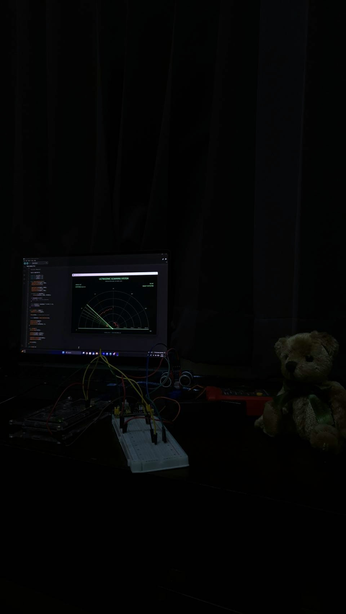
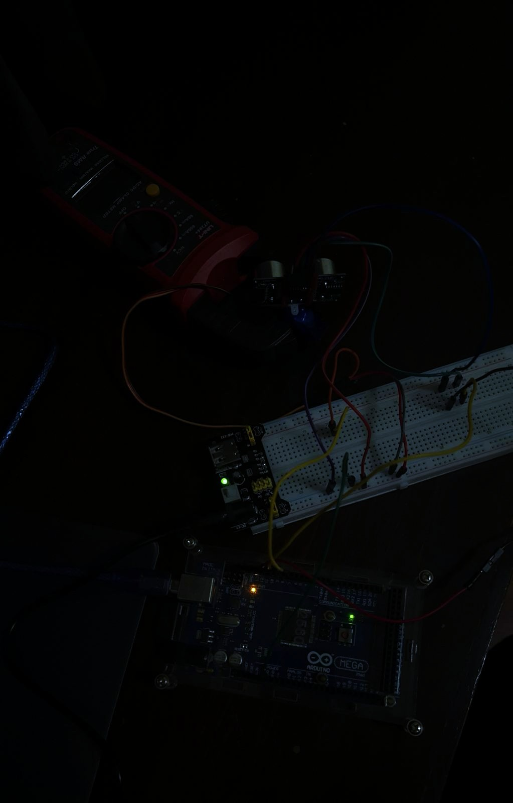
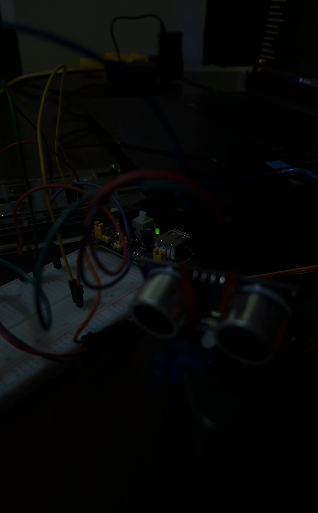
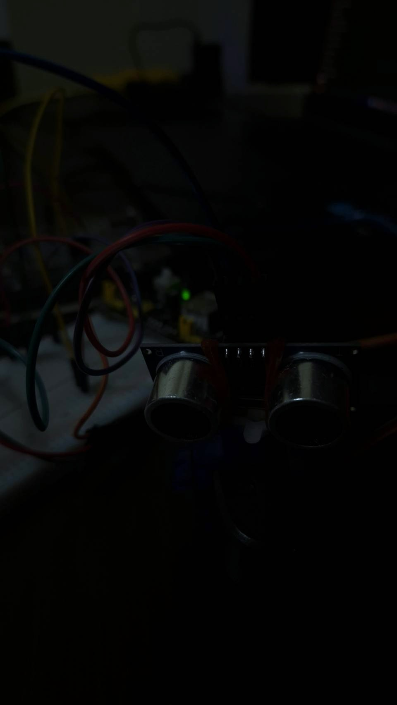
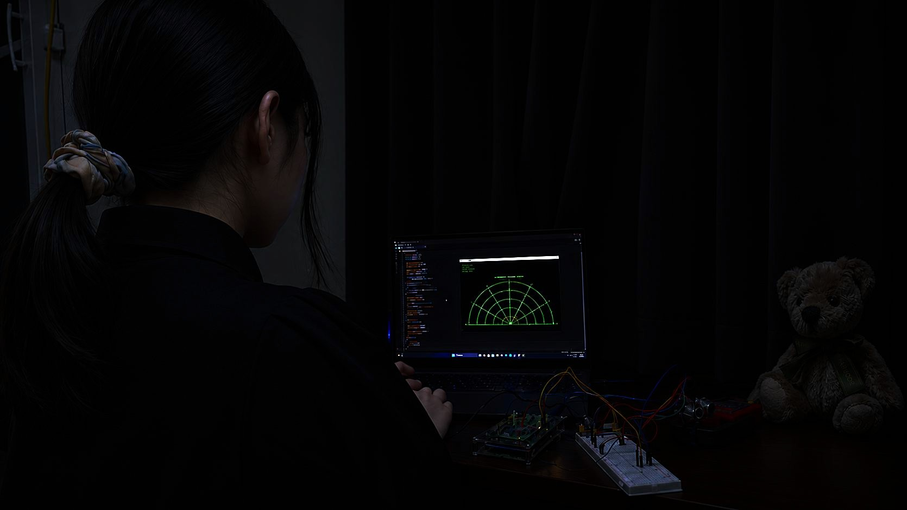

# Arduino Ultrasonic Radar System

### Real-Time Ultrasonic Scanning and Object Detection Using Arduino MEGA 2560

**Technologies:** Arduino · C++ · Processing (Java) · Embedded Systems · Electronics · Ultrasonic Sensing · Servo Motor Control · Serial Communication



## 1. Project Overview

This project is an Arduino-based ultrasonic scanning and object detection system developed using an Arduino MEGA 2560 microcontroller, an HC-SR04 ultrasonic sensor, an SG90 servo motor, and a real-time graphical interface built with Processing.

The objective is to develop a low-cost prototype capable of detecting nearby objects, estimating their distances, and displaying their relative positions through a continuously updating radar-style visualization.

The HC-SR04 ultrasonic sensor is mounted onto an SG90 servo motor, allowing it to rotate across a 140-degree scanning range. At each angular position, the Arduino triggers an ultrasonic measurement, calculates the distance to a detected object, and transmits the corresponding angle and distance to a computer through USB serial communication.

The Processing application receives this information and converts the measurements into a graphical display featuring a moving scanning line, distance rings, angular coordinates, and fading object-detection points.

The project integrates electrical circuit construction, embedded programming, sensor interfacing, actuator control, signal processing, and computer-based visualization.

**Technical note:** Although the graphical interface resembles conventional radar, the system uses ultrasonic sound waves rather than radio-frequency electromagnetic waves.

## 2. Project Objectives

The primary objectives are to:

- Develop a functional ultrasonic scanning system using readily available electronic components.
- Interface an HC-SR04 ultrasonic sensor with an Arduino MEGA 2560.
- Control an SG90 servo motor to scan across predetermined angular positions.
- Measure the distance to objects at different scanning angles.
- Implement multiple-sample filtering to reduce isolated measurement errors.
- Establish serial communication between the Arduino and a computer.
- Develop a real-time visualization using Processing.
- Investigate practical challenges involving power distribution, electrical connections, and hardware integration.
- Gain hands-on experience in embedded systems development and electronics prototyping.

## 3. Key Features

- **Ultrasonic Distance Measurement:** Uses an HC-SR04 sensor to estimate the distance to nearby objects.
- **Automated Angular Scanning:** Rotates the sensor between 20° and 160° in increments of 5°.
- **Real-Time Visualization:** Displays angular position and measured distance through a custom Processing interface.
- **Three-Sample Filtering:** Processes multiple ultrasonic readings at each angle to reduce isolated measurement outliers.
- **Bidirectional Scanning:** Continuously scans from left to right and back again.
- **Serial Communication:** Transmits angle and distance measurements through USB at 9600 baud.
- **Graphical Object Detection:** Represents detected objects as red points within a semicircular scanning grid.
- **Fading Detection Points:** Gradually removes older measurements to prevent indefinite accumulation of outdated data.
- **Live Status Monitoring:** Displays the current angle, measured distance, connection status, and detection status.
- **Configurable Display Range:** Uses a 100 cm visualization range, adjustable in the Processing source code.

## 4. Hardware Components

| Component | Quantity | Purpose |
|---|---|---|
| Arduino MEGA 2560 | 1 | Main microcontroller |
| HC-SR04 Ultrasonic Sensor | 1 | Distance measurement |
| SG90 Micro Servo Motor | 1 | Rotational movement |
| HW-131 Breadboard Power Supply | 1 | Regulated 5V power distribution |
| 9V DC Power Adapter | 1 | External input power for HW-131 |
| Breadboard | 1 | Prototyping and electrical connections |
| Jumper Wires | Multiple | Signal and power connections |
| Rubber Bands | As required | Temporary sensor mounting |
| USB Cable | 1 | Arduino programming and serial communication |
| Computer | 1 | Arduino IDE and Processing visualization |
| Digital Multimeter | 1 | Voltage measurement and troubleshooting |

### 4.1 Hardware Overview



The prototype consists of an Arduino MEGA 2560 connected to a breadboard containing the power distribution and signal connections.

The HC-SR04 ultrasonic sensor and SG90 servo motor form the rotating sensing assembly.

An HW-131 module provides regulated 5V power through the breadboard, while the Arduino receives power separately through its USB connection.

### 4.2 Ultrasonic Sensor and Servo Assembly



The HC-SR04 sensor is attached to the SG90 servo motor using rubber bands.

A dedicated mechanical mounting bracket was not available during construction, so rubber bands were used as a temporary mounting solution to secure the sensor while allowing the servo to rotate it.

This approach enabled functional testing without additional mechanical components.

However, the temporary mounting arrangement may introduce mechanical movement, vibration, or changes in sensor alignment. A rigid lightweight mounting bracket is planned as a future improvement.

### 4.3 Ultrasonic Sensor Close-Up



The HC-SR04 operates by transmitting ultrasonic pulses and measuring the time required for reflected sound waves to return to the receiver.

It provides the distance measurements used by the system's graphical interface.

## 5. Electrical Connections

The circuit uses a breadboard to distribute regulated 5V power and ground while routing control and measurement signals between the Arduino and the connected components.

Some signal connections use two jumper wires joined through electrically connected holes in the breadboard's central terminal area.

### 5.1 HC-SR04 Ultrasonic Sensor Connections

| HC-SR04 Pin | Connection |
|---|---|
| VCC | Breadboard red (+5V) power rail |
| TRIG | Breadboard central terminal row → Jumper wire → Arduino D10 |
| ECHO | Separate breadboard central terminal row → Jumper wire → Arduino D11 |
| GND | Breadboard blue (−) ground rail |

The TRIG and ECHO connections are routed through separate electrically isolated breadboard rows.

The TRIG pin receives a control pulse from Arduino digital pin D10.

The ECHO pin sends the resulting echo-duration signal to Arduino digital pin D11.

### 5.2 SG90 Servo Motor Connections

| Servo Wire | Connection |
|---|---|
| Orange (Signal) | Breadboard central terminal row → Jumper wire → Arduino D9 |
| Red (Power) | Breadboard red (+5V) power rail |
| Brown (Ground) | Breadboard blue (−) ground rail |

The servo's orange signal connection uses two jumper-wire segments connected through the breadboard's central terminal area.

The first connection runs from the servo signal wire to a breadboard row. A second jumper wire connects that same row to Arduino digital pin D9.

The servo receives regulated 5V power from the HW-131 module instead of drawing its operating current directly from the Arduino's 5V output.

### 5.3 Arduino MEGA 2560 Ground Connection

An additional jumper wire connects the Arduino MEGA 2560 POWER header to the breadboard's negative power rail.

**Connection:**

Arduino POWER header GND → Breadboard blue (−) ground rail

The Arduino POWER header contains two GND pins located after the 5V pin. Either of these GND pins can establish the required common-ground connection because they are electrically connected internally.

This shared ground is essential for consistent electrical reference levels between the Arduino, ultrasonic sensor, servo motor, and external power supply.

### 5.4 Power Supply Connections

| Source | Destination |
|---|---|
| Computer USB | Arduino MEGA 2560 |
| 9V DC Adapter | HW-131 DC input |
| HW-131 regulated +5V | Breadboard positive power rails |
| HW-131 GND | Breadboard negative power rails |
| Arduino GND | Breadboard negative power rail |

The Arduino MEGA 2560 is powered through the computer's USB connection.

The HW-131 receives 9V DC from an external adapter and provides regulated 5V to the ultrasonic sensor and servo through the breadboard power rails.

The HW-131 voltage-selection jumpers are configured for 5V output.

The Arduino 5V output is not directly connected to the HW-131 5V output, avoiding a direct connection between their positive power sources.

### 5.5 Electrical Considerations

- All devices must share a common ground for reliable signal referencing.
- The breadboard's positive rail must supply approximately 5V DC.
- The TRIG, ECHO, and servo signal connections must remain electrically separate.
- Power supply polarity must be verified before connecting components.
- The servo must not be connected directly to the unregulated 9V adapter.
- The HW-131 has limited output-current capability, so a suitably rated dedicated regulated 5V servo supply is recommended for more demanding operating conditions.

## 6. System Operation

The system operates through the coordinated interaction of the servo motor, ultrasonic sensor, Arduino microcontroller, and Processing visualization.

### Stage 1 — Servo Positioning

The Arduino commands the SG90 servo motor to rotate to a specified angle.

The scanning sequence begins at 20° and progresses toward 160° using 5° increments.

A short delay allows the servo to approach its commanded position before a distance measurement is taken.

### Stage 2 — Ultrasonic Transmission

The Arduino sends a 10-microsecond HIGH pulse to the HC-SR04 TRIG pin.

The ultrasonic sensor transmits a short burst of high-frequency sound.

### Stage 3 — Echo Reception

When the ultrasonic sound encounters an object, part of the wave is reflected toward the sensor.

The HC-SR04 produces an ECHO pulse whose duration corresponds to the sound's round-trip travel time.

### Stage 4 — Distance Calculation

The Arduino measures the echo pulse duration and estimates the distance using the speed of sound.

### Stage 5 — Measurement Filtering

The firmware takes three measurements at each angular position.

Valid readings are sorted, and the middle value is selected when an odd number of valid measurements is available.

When two valid measurements are available, their average is returned.

If no valid echo is received, the firmware returns -1 to indicate an unsuccessful measurement.

This approach reduces the influence of isolated extreme readings, although formal quantitative filtering-performance tests have not yet been completed.

### Stage 6 — Serial Data Transmission

The Arduino transmits the scanning angle and measured distance to the computer using the following format:

`angle,distance`

Example:

```text
20,32.5
25,31.8
30,28.4
35,22.6
40,18.1
```

The baud rate is set to 9600.

### Stage 7 — Processing Visualization

The Processing application receives the serial data and converts polar measurements into graphical coordinates.

The measured distance determines the radial position of an object, while the scanning angle determines its direction.

Valid detections are displayed as red points, and the current scanning direction is represented by a green sweep line.

### Stage 8 — Continuous Scanning

After reaching 160°, the servo reverses direction and scans back toward 20°.

The cycle repeats continuously while the system remains powered.

## 7. Ultrasonic Distance Calculation

The fundamental distance equation is:

\[
d=\frac{vt}{2}
\]

Where:

- \(d\) = distance between the sensor and object
- \(v\) = speed of sound
- \(t\) = measured echo pulse duration

Assuming a speed of sound of approximately 343 m/s at room temperature:

\[
v=0.0343\ \text{cm}/\mu\text{s}
\]

Therefore:

\[
d=\frac{0.0343t}{2}
\]

The Arduino implementation is:

```cpp
float distance = duration * 0.0343 / 2.0;
```

The division by two accounts for the outbound and return portions of the ultrasonic wave's journey.

### Example Calculation

For an echo duration of 1500 microseconds:

\[
d=\frac{1500(0.0343)}{2}
\]

\[
\boxed{d=25.725\ \text{cm}}
\]

This is an illustrative calculation rather than a recorded experimental measurement.

## 8. Software Development

The project uses two separate development environments.

### 8.1 Arduino IDE — Embedded Firmware

The Arduino firmware is written in C++ using the Arduino framework.

It is responsible for:

- Configuring digital input and output pins
- Controlling the SG90 servo motor
- Triggering ultrasonic measurements
- Measuring echo pulse durations
- Processing multiple measurements
- Managing the scanning sequence
- Transmitting serial data to the computer

**Source code:**

[arduino_radar.ino](arduino_radar/arduino_radar.ino)

### 8.2 Processing — Radar Visualization

The radar visualization is developed in Processing using Java Mode.

The program receives serial data from the Arduino and renders the measurements in a custom graphical interface.

Its features include:

- Semicircular radar grid
- Angular measurement labels
- Distance reference rings
- Real-time scanning line
- Fading sweep trail
- Object detection points
- Detection status
- Live angle and distance values
- Connection status monitoring

**Source code:**

[Radar_display_v2.pde](Radar_display_v2/Radar_display_v2.pde)

### 8.3 Processing V2 Display


The visualization uses a 100 cm display range with five radial distance intervals.

Recent object detections are displayed as red points, while older detections gradually fade over a configurable 12-second interval.

The software distinguishes between valid detections, measurements outside the visualization range, and missing echoes.

## 9. Running the Project

### Requirements

**Software:**

- Arduino IDE
- Processing (Java Mode)
- Arduino Servo library
- Processing Serial library

**Hardware:**

- Assembled Arduino ultrasonic scanning circuit
- USB connection between Arduino and computer
- Regulated servo power supply

### Step 1 — Assemble the Hardware

Connect the ultrasonic sensor, servo motor, Arduino, breadboard, and power supply according to the electrical connections documented above.

Ensure that the Arduino and external supply share a common ground.

Verify the voltage and polarity before connecting the components.

### Step 2 — Upload Arduino Firmware

1. Open Arduino IDE.
2. Open `arduino_radar/arduino_radar.ino`.
3. Select Arduino MEGA 2560 as the board.
4. Select the correct USB serial port.
5. Verify and upload the firmware.

The original development setup used COM4, although the assigned serial port may vary between computers or USB connections.

### Step 3 — Verify Serial Communication

Open the Arduino Serial Monitor and set the baud rate to 9600.

The firmware should produce comma-separated angle and distance measurements.

Close the Serial Monitor before opening the Processing application.

### Step 4 — Launch Processing

1. Open Processing in Java Mode.
2. Open `Radar_display_v2/Radar_display_v2.pde`.
3. Confirm that the serial port setting matches the Arduino's current port.
4. Keep the Arduino connected through USB.
5. Power the servo supply.
6. Run the Processing sketch.

### Step 5 — Test Object Detection

Place a suitable flat object within the sensor's scanning area.

As the sensor rotates toward the object, corresponding detection points should appear on the radar display.

The displayed distance should change as the relative position of the object changes.

### Important Notes

- Arduino IDE and Processing must not attempt to open the same serial port simultaneously.
- Ensure the sensor and servo wiring does not restrict mechanical rotation.
- Do not forcibly rotate or obstruct the servo.
- If the supply voltage becomes unstable, the servo stalls, or any component overheats, switch off the system and investigate before continuing.

## 10. Engineering Challenges and Troubleshooting

The project required several rounds of hardware and software troubleshooting before achieving a functional prototype.

### 10.1 Servo Power Supply Issues

During initial testing, the SG90 servo failed to rotate even though the Arduino firmware compiled and uploaded successfully.

This required investigation of the servo connections, power distribution, and HW-131 breadboard power module.

The power supply was tested using a digital multimeter, and the voltage-selection jumpers and module positioning were checked.

The troubleshooting process demonstrated the importance of verifying regulated supply voltage, correct polarity, secure connections, and supply behavior under load.

### 10.2 Breadboard Power Distribution

One challenge involved understanding how the HW-131 distributes power to the breadboard.

The physical alignment of the module's positive and negative pins with the corresponding breadboard power rails was important.

Additional testing helped distinguish between the power module's output and the voltage actually available at the intended breadboard connections.

### 10.3 Common Ground Connections

Establishing a common ground between the USB-powered Arduino and the externally powered components was essential.

An Arduino GND pin was connected to the breadboard's negative rail, creating a shared electrical reference for the servo control and ultrasonic sensor signals.

### 10.4 Arduino USB Communication

During firmware uploading, the computer initially failed to communicate with the Arduino through the selected serial port.

The issue was resolved by identifying and selecting the correct COM port.

This reinforced the importance of understanding serial communication and device configuration.

### 10.5 Arduino IDE and Processing Compatibility

The project uses two different programming environments.

Arduino IDE is responsible for compiling and uploading the embedded firmware, while Processing executes the graphical radar application on the computer.

Initial compilation errors helped clarify the distinction between Arduino-compatible C++ and Processing's Java-based programming environment.

### 10.6 Mechanical Sensor Mounting

A dedicated bracket for the ultrasonic sensor was unavailable.

Rubber bands were therefore used to secure the HC-SR04 sensor to the SG90 servo motor.

Although sufficient for initial functional testing, the temporary mounting method may affect mechanical stability and measurement consistency.

### 10.7 Radar Visualization Development

The graphical interface was developed and refined through multiple iterations.

The initial version displayed a basic scanning grid, detection points, and live angle and distance information.

Version 2 introduced improved visual organization, fading detections, scanning trails, and clearer status information.

## 11. Prototype Demonstration



The prototype demonstrates a rotating ultrasonic sensor communicating with a computer-based visualization.

The system has successfully demonstrated:

- Servo-controlled angular scanning
- Ultrasonic distance measurement
- Real-time serial data transmission
- Graphical representation of detected objects
- Live visualization of sensor movement
- Detection of objects placed within the scanning area

A demonstration video has also been recorded for project documentation.

## 12. Testing and Current Results

### Functional Testing

Functional testing has confirmed that the main components can operate together as an integrated ultrasonic scanning system.

The HC-SR04 has successfully detected objects placed in front of the sensor.

The SG90 has successfully rotated the sensing assembly.

The Arduino has successfully transmitted measurement data to the computer.

The Processing V2 application has successfully displayed the resulting measurements through its radar-style interface.

### Measurement Accuracy

Formal quantitative accuracy testing has not yet been completed.

Planned testing includes comparing ultrasonic measurements against known distances using a ruler or measuring tape.

Suggested testing distances include 10 cm, 20 cm, 30 cm, and 50 cm.

Percentage error will be calculated using:

\[
\%\text{ Error}=
\frac{|d_{\text{measured}}-d_{\text{actual}}|}
{d_{\text{actual}}}\times100
\]

Repeated measurements will also be used to examine measurement variation and the effect of filtering.

No unverified numerical accuracy claims are made at this stage.

## 13. System Limitations

The current prototype has several limitations:

- The sensor uses temporary rubber-band mounting rather than a rigid mechanical bracket.
- Ultrasonic measurements depend on object geometry, material, and orientation.
- The displayed angular position is based on the commanded servo angle rather than independent angular feedback.
- The 100 cm graphical display range is a software setting rather than the sensor's absolute operating limit.
- The system depends on a wired connection to the computer.
- The servo power supply has limited current capacity.
- Multiple measurements at each angle increase the overall scan duration.
- The system does not perform autonomous navigation or object classification.
- Formal calibration and reliability testing remain incomplete.

These limitations provide opportunities for future engineering improvements.

## 14. Future Improvements

### Mechanical Design

- Replace the rubber-band mount with a rigid lightweight bracket.
- Improve sensor alignment and mechanical stability.
- Organize wiring to reduce interference with servo rotation.

### Electrical Design

- Introduce a more robust regulated 5V supply with adequate servo current capacity.
- Improve circuit layout and power distribution.
- Develop a cleaner and more permanent assembly.

### Signal Processing

- Compare raw ultrasonic measurements with filtered measurements.
- Investigate measurement repeatability and noise characteristics.
- Evaluate additional filtering and outlier-rejection approaches.

### Software Development

- Add CSV measurement logging.
- Introduce more detailed object-distance analysis.
- Improve visualization of persistent and moving objects.
- Support exporting recorded scan data.

### Advanced Development

- Explore multi-sensor integration.
- Investigate object tracking across successive scans.
- Explore applications involving robotic perception and environmental sensing.
- Investigate integration with more advanced robotic platforms.

## 15. Skills and Knowledge Developed

This project provided practical experience in:

**Electrical and Electronic Engineering**
- Circuit construction and breadboard prototyping
- Regulated DC power distribution
- Voltage measurement and troubleshooting
- Sensor and actuator interfacing
- Common-ground and signal-reference principles

**Embedded Systems**
- Arduino MEGA 2560 programming
- Digital input and output
- Timing-based ultrasonic measurements
- Servo motor control
- Serial communication
- Basic measurement filtering

**Software Development**
- C++ programming
- Processing and Java-based visualization
- Real-time data handling
- Graphical coordinate mapping
- Hardware-software integration
- Debugging and troubleshooting

**Engineering Development**
- Rapid prototyping
- Component integration
- Functional testing
- Technical documentation
- Identifying system limitations
- Iterative design improvement

## 16. Project Gallery

### Complete System


### Hardware Prototype


### Ultrasonic Sensor and Servo Assembly


### Real-Time Radar Visualization


### Development and Demonstration


## 17. Project Repository Structure

```text
arduino-ultrasonic-radar/
│
├── arduino_radar/
│   └── arduino_radar.ino
│
├── Radar_display_v2/
│   └── Radar_display_v2.pde
│
├── images/
│   ├── complete-system-setup.jpg
│   ├── hardware-overview.jpg
│   ├── sensor-servo-assembly.jpg
│   ├── hc-sr04-sensor.jpg
│   ├── live-system-demonstration.jpg
│   ├── Processing V2 Screenshot.png
│   └── README.md
│
├── README.md
└── LICENSE
```

## 18. Conclusion

This project demonstrates the successful integration of embedded control, ultrasonic sensing, servo actuation, and real-time graphical visualization into a functional prototype.

Beyond implementing a working scanning system, the development process provided practical experience in diagnosing power supply issues, managing breadboard connections, configuring serial communication, and coordinating hardware with software.

The prototype provides a foundation for further exploration of robotic perception, embedded sensing, signal processing, and electronic system development.

Future work will focus on improving mechanical reliability, validating measurement accuracy, refining data processing, and extending the system's sensing capabilities.

## 19. License

This project is licensed under the MIT License.

See the [LICENSE](LICENSE) file for details.
